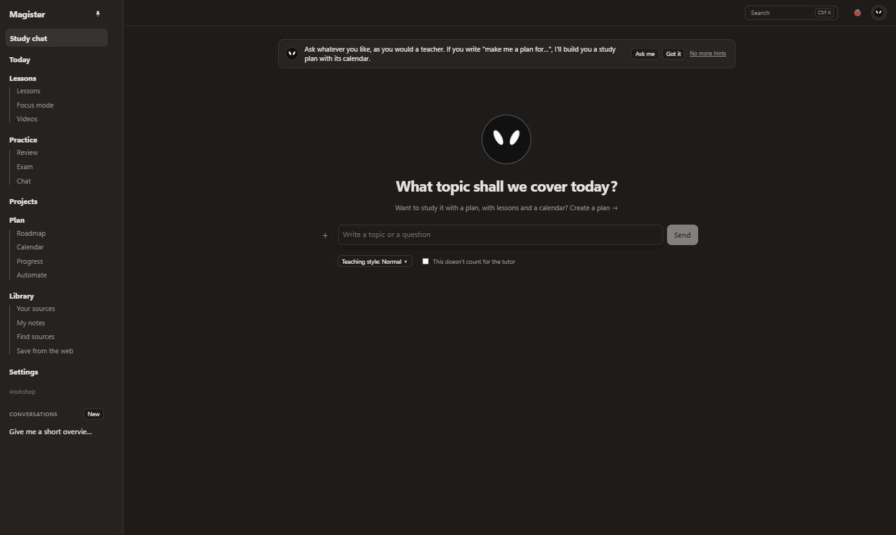
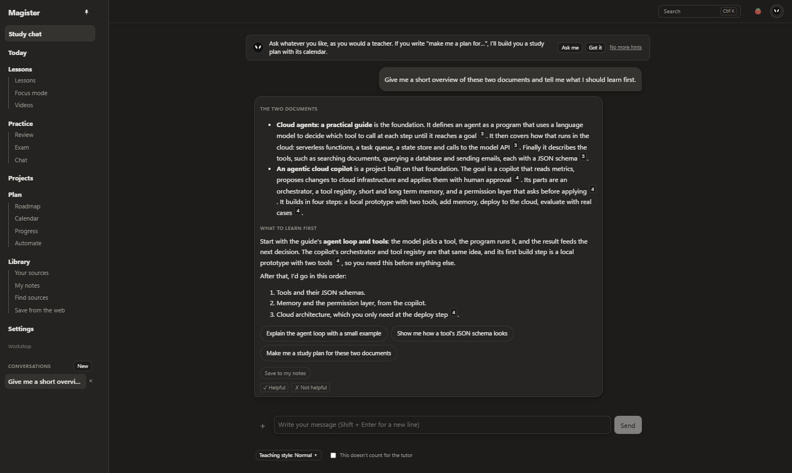
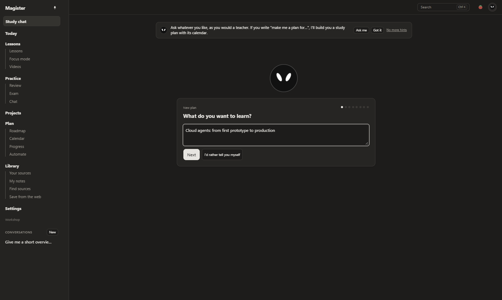
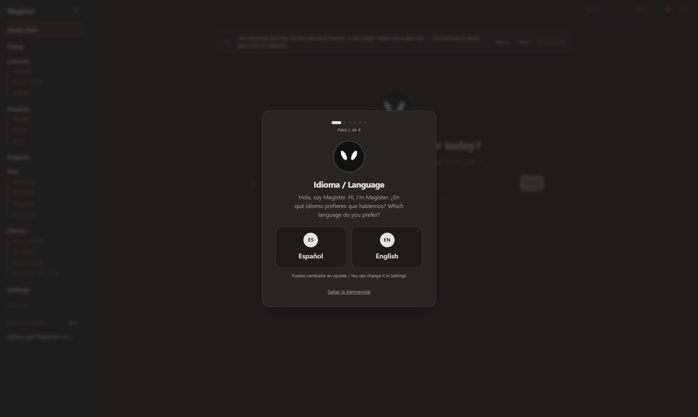

# Magister Studio

**Un tutor personal con IA que planifica lo que estudias, te lo enseña con tus propias fuentes, te pregunta y te programa los repasos.**

[Read in English](README.md)



Le cuentas a Magister qué quieres aprender, para qué, qué sabes ya y cuántas horas tienes. Te prepara un plan con lecciones y calendario, escribe los apuntes de cada lección (citando tus PDF y apuntes cuando los tienes), te pregunta, te corrige explicando *por qué* fallaste y te devuelve lo que estás a punto de olvidar. Funciona en tu ordenador y habla con Claude con tu propia suscripción.

## Descargar

Necesitas una suscripción de **Claude Pro o Max**. Magister usa tu propia cuenta; no se comparte con nadie.

| | |
|---|---|
| **Windows** | Descarga [Magister-Windows.zip](https://github.com/Portaltocoding/magister-studio/releases/latest/download/Magister-Windows.zip), extráelo y haz doble clic en `Magister.bat`. |
| **Mac** | Abre Terminal y pega `curl -fsSL https://raw.githubusercontent.com/Portaltocoding/magister-studio/main/instalar-mac.sh \| bash`, o descarga [Magister-Mac.zip](https://github.com/Portaltocoding/magister-studio/releases/latest/download/Magister-Mac.zip) y haz doble clic en `Magister.command`. |
| **Linux** | Clona el repo y lanza `bash magister.sh`. |
| **Sin Docker** | [Magister-Windows-sin-Docker.zip](https://github.com/Portaltocoding/magister-studio/releases/latest/download/Magister-Windows-sin-Docker.zip) (unos 0,6 GB, lleva todo dentro) o, en Mac, `curl -fsSL https://raw.githubusercontent.com/Portaltocoding/magister-studio/main/instalar-mac-sin-docker.sh \| bash` ([zip](https://github.com/Portaltocoding/magister-studio/releases/latest/download/Magister-Mac-sin-Docker.zip)). Más ligero, pero más nuevo y menos probado; en Windows tu cuenta de Claude se conecta en la ventana negra la primera vez. Cuál elegir: [docs/instalar.md](docs/instalar.md). |

El arrancador instala Docker si falta, descarga Magister (unos 2 GB la primera vez) y lo abre en el navegador. Una bienvenida corta con la mascota te pregunta el idioma y tu nombre, conecta tu cuenta de Claude y comprueba que la voz funciona. Paso a paso, actualizar y problemas frecuentes: **[docs/instalar.md](docs/instalar.md)**.

> El instalador de un clic es nuevo. Si algo falla, abre una issue contando qué veías en pantalla.

## Qué hace

**Decide qué estudias, para que no tengas que hacerlo tú**
- **Un plan a partir de una conversación.** Un cuestionario corto (objetivo, nivel, profundidad, plazo, horas, franja) se convierte en lecciones con sus requisitos, comprobadas por código (sin ciclos, horas realistas) y repartidas en tu calendario.
- **«Lo que toca hoy».** Cada día monta la sesión: primero los repasos que vencen (los que aún se salvan con poco esfuerzo) y después la lección siguiente. Si te atrasas, *Reajustar* recoloca el calendario dejando sitio a los repasos, y tú lo apruebas.

**Te enseña con tu material**
- **Apuntes por bloques** de 250 a 450 palabras con definiciones, fórmulas, un diagrama por apartado y un «repaso sin mirar», además de fichas y un mapa de conceptos.
- **Tus fuentes.** Sube PDF, Markdown, texto o páginas web. Las respuestas las citan con marcas `[n]` que abren el fragmento exacto; las citas se comprueban sin el modelo y las dudosas se marcan. Si una lección no tiene material, Magister puede buscar fuentes en la web y te pregunta antes de añadirlas.
- **Formatos.** Diagramas, diapositivas, un «libro» del tema en PDF, lectura en voz alta y vídeos animados narrados para las lecciones más difíciles (voz local, exportables a MP4).
- **Un tutor que sabe dónde estás.** Pregunta lo que quieras en *Estudio libre*: el tutor ve la lección, tus conceptos flojos y dominados y tu historial reciente.

**Comprueba que de verdad lo has aprendido**
- **Preguntas de varios tipos:** conceptuales, de cálculo, de encontrar el fallo, de escenario, habladas y tipo test, y exámenes.
- **Correcciones que enseñan.** Cada respuesta recibe *fallo / parcial / bien / perfecta*, las ideas que pusiste y las que faltaron, el tipo de error (olvido, confusión, concepto, incompleta, fuera de tema) y una cita de la fuente. Puedes discutir la nota.
- **Repaso espaciado.** FSRS-6 ajustado a ti. Una red neuronal de olvido se entrena con tu historial y solo manda si gana a FSRS dos veces seguidas. Lo que fallas vuelve en la misma sesión con otra pregunta, y esos reintentos no falsean el programador.

**Te ayuda a concentrarte**
- **Modo foco:** una idea cada vez, modo zen, y retomas en el párrafo exacto en el que lo dejaste. Pomodoro, un aviso diario, racha y una página de progreso con tu calibración (¿estás tan seguro como aciertas?).
- **Modo voz** para estudiar hablando, un **asesor de proyectos** que lee tu plan y tus notas y te propone cambios que aplicas con un botón, y una mascota animada a elegir en Ajustes.
- **Inglés o español**, a elegir en la bienvenida o en Ajustes.
- **Tus datos son tuyos:** todo funciona en tu equipo salvo las llamadas a Claude. Copias diarias, y puedes exportarlo o borrarlo todo.

**Lo que (todavía) no hace:** el orden de las lecciones queda fijo al aceptar un plan (se adapta el calendario, no la secuencia), los avisos necesitan la pestaña abierta y no hay versión móvil.

## Capturas

Las capturas están en inglés; en español, la app se ve igual.

| | |
|---|---|
|  |  |
| **Estudio libre** lee lo que adjuntas, responde citándolo y te ofrece cómo seguir. | **Un plan** empieza con unas preguntas: objetivo, nivel, profundidad, plazo y horas. |
|  |  |
| **La bienvenida** te pregunta el idioma y tu nombre, y conecta tu cuenta de Claude. | **Siempre en oscuro**, con la barra lateral fija; la pliegas si prefieres. |

## Cómo está hecho

| | |
|---|---|
| Servidor | Python 3.12, FastAPI, SQLAlchemy asíncrono, Alembic, LangGraph |
| Datos | Postgres 16 con pgvector; embeddings (e5 multilingüe) y reranker (mMARCO) locales para la búsqueda |
| Modelo | Claude con `claude -p`, con un enrutador por tarea (Haiku para extraer, juzgar y el asesor) y prompts versionados |
| Web | React, Vite, TypeScript; Remotion para los vídeos; Piper para la voz local; ffmpeg para el MP4 |
| Empaquetado | Imágenes de Docker para amd64 y arm64 en GHCR, construidas con GitHub Actions |

Algunas decisiones, con números:
- **Un flujo fijo de research en vez de un agente** ([ADR-0008](docs/adr/0008-research.md)): en un banco de 8 tareas el agente acertó el 100 % frente al 75 %, pero con 4 veces las llamadas y 3 veces el tiempo. Se quedó el flujo fijo.
- **Medir antes de cambiar la búsqueda** ([ADR-0018](docs/adr/0018-fuentes-en-otro-idioma.md)): trocear las notas por apartados empató en el banco de 20 preguntas (MRR de sección 0,567 → 0,571) y arregló un fallo real, sin bajar los umbrales de relevancia.
- **El texto de fuera nunca da órdenes:** las respuestas del alumno y el contenido web van delimitados, con sus etiquetas neutralizadas, antes de llegar a cualquier prompt.
- **Probado por agentes:** seis probadores usaron la app a la vez con seis temas y encontraron, entre otros, una regla CSP que silenciaba el audio, una inyección de prompt en el corrector y una cola de un solo trabajo. Todo arreglado.

Arquitectura, contratos y cada decisión: [`docs/`](docs/) (design doc, ADR, runbooks). Construido capítulo a capítulo siguiendo el libro de *magister* (Partes I a VI); las decisiones están en [`docs/decisiones.md`](docs/decisiones.md).

## Desarrollo

Necesitas Docker Desktop, [uv](https://docs.astral.sh/uv/), Node 22 y el CLI de Claude Code con tu sesión iniciada.

```powershell
.\arrancar.ps1          # Windows: base, migraciones, página y http://localhost:8000
```

| | |
|---|---|
| Pruebas del servidor (sin llamar al modelo) | `cd servidor && uv run pytest -q` |
| Pruebas y build de la web | `cd web && npm test && npm run build` |
| Recarga en caliente | `docker compose up -d` · `cd servidor && uv run uvicorn magister.api.app:app --port 8000` · `cd web && npm run dev` |
| Chuleta de órdenes | `cd servidor && uv run magister ayuda` |
| Evals (gastan cuota) | `cd servidor && uv run python -m evals.suite` |

Las reglas de los módulos están en [`CLAUDE.md`](CLAUDE.md).

## Licencia

[MIT](LICENSE). Los componentes de terceros mantienen sus licencias ([CREDITOS.md](CREDITOS.md)); Remotion es gratis para particulares y equipos pequeños.
