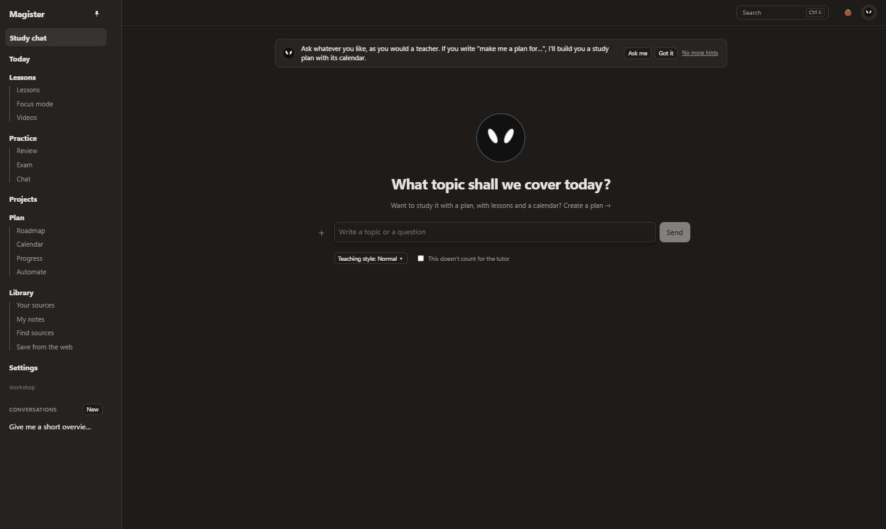

# Magister Studio

**A personal AI tutor that plans what you study, teaches it from your own sources, quizzes you and schedules your reviews.**

[Leer en español](README.es.md)



You tell Magister what you want to learn, why, what you already know and how many hours you have. It builds a plan with lessons and a calendar, writes the notes for each lesson (citing your PDFs and notes when you have them), asks you questions, corrects you explaining *why* you were wrong, and brings back what you are about to forget. It runs on your computer and talks to Claude with your own subscription.

## Download

You need a **Claude Pro or Max** subscription. Magister uses your own account; nothing is shared with anyone else.

| | |
|---|---|
| **Windows** | Download [Magister-Windows.zip](https://github.com/Portaltocoding/magister-studio/releases/latest/download/Magister-Windows.zip), extract it and double-click `Magister.bat`. |
| **Mac** | Open Terminal and paste `curl -fsSL https://raw.githubusercontent.com/Portaltocoding/magister-studio/main/instalar-mac.sh \| bash` — or download [Magister-Mac.zip](https://github.com/Portaltocoding/magister-studio/releases/latest/download/Magister-Mac.zip) and double-click `Magister.command`. |
| **Linux** | Clone the repo and run `bash magister.sh`. |

The launcher installs Docker if it is missing, downloads Magister (about 2 GB the first time) and opens it in your browser. A short welcome with the mascot asks for your language and your name, connects your Claude account and checks that the voice works. Step by step, updating and troubleshooting: **[docs/instalar.md](docs/instalar.md)**.

> The one-click installer is new. If something goes wrong, please open an issue with what you saw on screen.

## What it does

**It decides what you study, so you don't have to**
- **A plan from a conversation.** A short questionnaire (goal, level, depth, deadline, hours, time of day) becomes a list of lessons with prerequisites, checked by code (no dependency cycles, realistic hours) and spread over your calendar.
- **"What's today".** Every day it puts together the session: due reviews first (the ones still cheap to save), then the next lesson. If you fall behind, *Rebalance* moves the calendar keeping room for reviews; you approve it.

**It teaches from your material**
- **Notes in blocks** of 250–450 words with definitions, formulas, a diagram per section and a "recall without looking" box, plus flashcards and a concept map.
- **Your sources.** Upload PDFs, Markdown, text or web pages. Answers cite them with `[n]` marks you can open to see the exact passage; citations are checked without the model, and doubtful ones are flagged. When a lesson has no material, Magister can research sources on the web and asks you before adding them.
- **Formats.** Diagrams, slides, a PDF "book" of the topic, read-aloud, and short narrated animated videos for the hardest lessons (local voice, exportable to MP4).
- **A tutor that knows where you are.** Ask anything in *Free study*; the tutor sees the lesson, your weak and mastered concepts and your recent history.

**It checks that you really learned it**
- **Questions of several kinds:** conceptual, calculation, spot-the-mistake, scenario, spoken and multiple choice, plus exams.
- **Corrections that teach.** Each answer gets *wrong / partial / good / perfect*, the ideas you got and the ones you missed, the type of error (forgot, confused, misconception, incomplete, off topic) and a quote from the source. You can dispute the mark.
- **Spaced repetition.** FSRS-6, adjusted to you. A neural forgetting model trains on your history and only takes over if it beats FSRS twice in a row. What you get wrong comes back in the same session with a different question, and those retries don't distort the scheduler.

**It helps you focus**
- **Focus mode:** one idea at a time, zen mode, and it resumes at the exact paragraph you left. Pomodoro, a daily reminder, streaks and a progress page with calibration (are you as sure as you are right?).
- **Voice mode** to study talking, a **project advisor** that reads your plan and notes and proposes changes you apply with a button, and an animated mascot to pick in Settings.
- **English or Spanish**, chosen in the welcome or in Settings.
- **Your data stays with you:** everything runs locally except the calls to Claude. Daily backups, and you can export or delete everything.

**What it doesn't do (yet):** the order of lessons is fixed once you accept a plan (the calendar adapts, the sequence doesn't), reminders need the browser tab open, and there is no mobile version.

## How it is built

| | |
|---|---|
| Server | Python 3.12, FastAPI, SQLAlchemy async, Alembic, LangGraph |
| Data | Postgres 16 with pgvector; local embeddings (multilingual e5) and reranker (mMARCO) for retrieval |
| Model | Claude through `claude -p`, with a router per task (Haiku for extraction, judging and the in-app advisor) and versioned prompts |
| Web | React, Vite, TypeScript; Remotion for the animated videos; Piper for local voice; ffmpeg for MP4 |
| Packaging | Docker images for amd64 and arm64 on GHCR, built by GitHub Actions |

Some decisions, with numbers:
- **A fixed research flow instead of an agent** ([ADR-0008](docs/adr/0008-research.md)): on an 8-task bench the agent succeeded 100% vs 75%, but with 4× the calls and 3× the time. The fixed flow stayed.
- **Measure before changing retrieval** ([ADR-0018](docs/adr/0018-fuentes-en-otro-idioma.md)): splitting notes by headings tied the 20-question bank (section MRR 0.567 → 0.571) and fixed a real miss, without lowering the relevance thresholds.
- **External text never gives orders:** user answers and web content are delimited and their tags neutralised before reaching any prompt.
- **Tested by agents:** six parallel testers used the app on six topics and found, among others, a CSP rule muting the audio, a prompt injection in the corrector and a single-worker job queue. All fixed.

Architecture, contracts and every decision: [`docs/`](docs/) (design doc, ADRs, runbooks). Built chapter by chapter following the *magister* book (Parts I–VI); the choices are in [`docs/decisiones.md`](docs/decisiones.md).

## Development

You need Docker Desktop, [uv](https://docs.astral.sh/uv/), Node 22 and the Claude Code CLI logged in.

```powershell
.\arrancar.ps1          # Windows: database, migrations, page build and http://localhost:8000
```

| | |
|---|---|
| Server tests (no model calls) | `cd servidor && uv run pytest -q` |
| Web tests and build | `cd web && npm test && npm run build` |
| Hot reload | `docker compose up -d` · `cd servidor && uv run uvicorn magister.api.app:app --port 8000` · `cd web && npm run dev` |
| Command cheat sheet | `cd servidor && uv run magister ayuda` |
| Evals (they use your quota) | `cd servidor && uv run python -m evals.suite` |

The code, variables and docs are in Spanish; [`CLAUDE.md`](CLAUDE.md) has the module rules.

## Licence

[MIT](LICENSE). Third-party components keep their own licences ([CREDITOS.md](CREDITOS.md)); Remotion is free for individuals and small teams.
